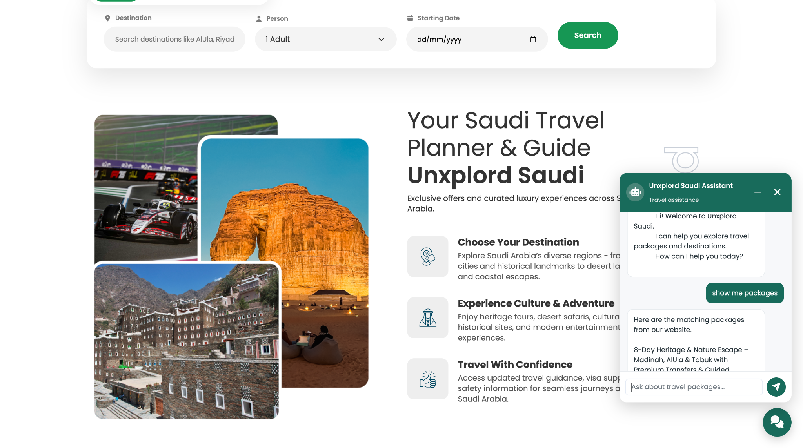
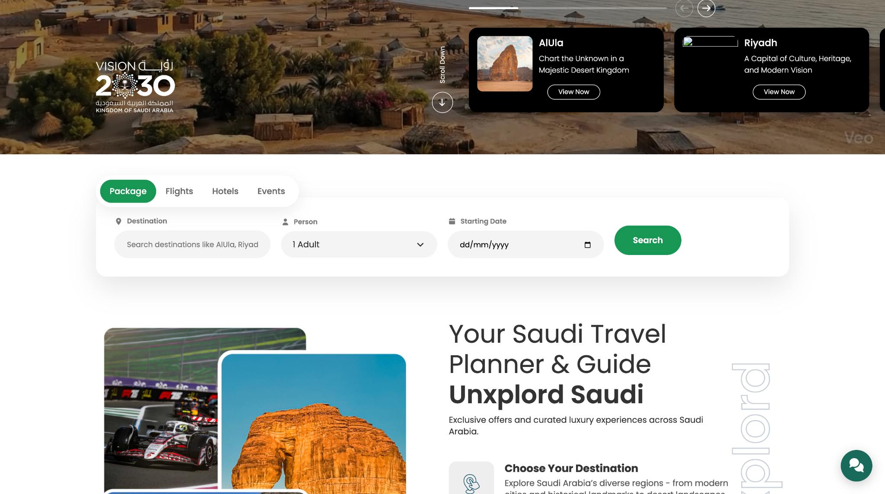
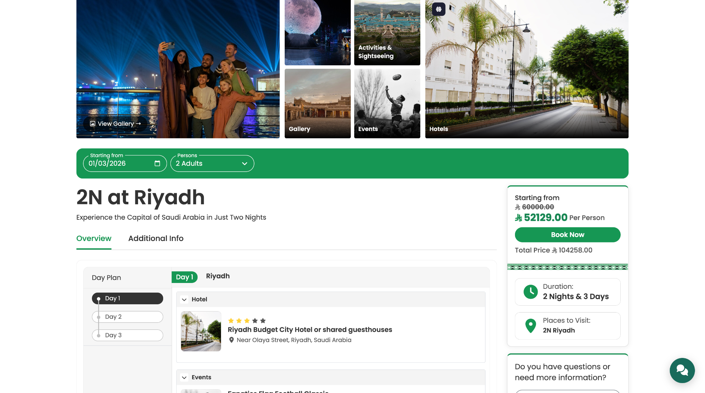

# Unxplord Saudi – Saudi Arabia Travel Platform

Unxplord Saudi is a travel discovery and booking platform designed to help visitors explore Saudi Arabia, discover curated travel packages and plan trips across destinations such as Riyadh and AlUla. The customer-facing website brings package discovery, destination inspiration and travel assistance into one experience.

> **Project showcase:** This is a client project. This repository README and screenshots describe selected product features only. Private backend implementation, database migrations, credentials, customer information and proprietary business logic are intentionally not included.

---

## Project Overview

The platform is organised around two main experiences:

- **Frontend website:** A responsive travel website where visitors can explore destinations, search travel options, review packages and start a booking.
- **Backend / administration:** Management capabilities for maintaining travel content and handling the operational workflow for packages, events, hotels, travel services and bookings.

## Frontend Features

- Travel-focused homepage with destination and experience highlights.
- Hero banner and featured destination cards.
- Search interface for travel packages, flights, hotels and events.
- Search fields for destination, traveller count and starting date.
- Curated Saudi travel packages with package detail pages.
- Day-wise itinerary presentation.
- Hotel and event information within package itineraries.
- Package price summary, duration and places-to-visit information.
- Booking call-to-action and customer enquiry flow.
- Travel assistant chat interface to help visitors discover matching packages.
- Responsive layouts for desktop and mobile browsing.

## Backend & Management Features

The backend is intended to support the core travel business workflow:

| Module | Management responsibilities |
|---|---|
| Destinations | Manage Saudi destinations, descriptions, images and highlights |
| Travel packages | Create and update packages, pricing, duration, inclusions and itinerary days |
| Package itinerary | Organise day-wise activities, destinations, hotels and experiences |
| Events | Add and manage events, dates, locations, descriptions and related travel information |
| To-do / activities | Manage traveller activities, things to do and experiences associated with destinations or packages |
| Hotels | Maintain hotel information, location, descriptions, images and package associations |
| Travel services | Manage travel-related services and information used in package planning |
| Bookings | Receive and manage package booking requests, traveller details, dates, booking status and customer enquiries |
| Content management | Maintain homepage sections, destination content, galleries and promotional information |

*The table documents the intended product modules and scope. Adjust individual items to match the exact features currently enabled in the deployed admin panel.*

## Booking Workflow

1. A visitor opens the website and searches by destination, traveller count and starting date.
2. The visitor explores matching travel packages.
3. The visitor opens a package details page and reviews its itinerary, hotels, events, activities, duration and price.
4. The visitor selects **Book Now** or submits a booking enquiry.
5. Booking information is sent to the platform for the team to review and manage.
6. The team follows up with the customer to confirm availability and booking details.

## Example Package: 2 Nights in Riyadh

The screenshots include a sample **2N at Riyadh** package page with:

- Package overview and additional information tabs.
- Starting price and total price summary.
- Two-night / three-day duration information.
- Day-wise itinerary.
- Hotel and event sections.
- Places-to-visit information.
- Booking call-to-action.

## Technology

The exact stack and versions should reflect the deployed project. If this repository contains the Laravel implementation, document the actual versions here, for example:

- Backend: PHP / Laravel
- Database: MySQL or MariaDB
- Frontend: HTML, CSS, JavaScript and the project's selected UI framework
- Build tooling: Composer and npm / Vite, if configured

Do not list technologies or integrations that are not actually used in the project.

## Screenshots

### Homepage and travel search


### Homepage destination discovery


### Travel assistant



### Package discovery through assistant



### Package details and itinerary



## Local Setup

Setup instructions depend on the actual source code and deployment configuration. For a Laravel-based version, the general workflow is:

```bash
git clone https://github.com/atulKumar805825/unxplordsaudi.git
cd unxplordsaudi

composer install
cp .env.example .env
php artisan key:generate
```

Configure the database and other required services in `.env`, then run the project-specific migrations and frontend build:

```bash
php artisan migrate
npm install
npm run build
php artisan serve
```

Only run migrations against a local or approved development database. The public showcase repository may intentionally omit migrations and private implementation files, so these setup commands may require the authorised complete project source.

## Repository & Client Confidentiality

This is a client project. The public repository is intended to showcase the product experience, selected screenshots and high-level feature scope—not to distribute the complete application.

Do not commit:

- `.env` files, API keys, passwords, tokens or other credentials.
- Database migrations, production database exports or real customer data.
- Private backend services, proprietary business rules or confidential integrations.
- Private frontend layouts, templates or client-owned assets unless approved for publication.
- Logs, private uploads, backups or server configuration containing sensitive information.

**Important:** A public GitHub repository can be cloned and downloaded. `.gitignore` prevents selected untracked files from being added, but it does not remove files already committed or erase them from Git history. Rotate any exposed credentials and clean repository history before publishing sensitive material.

## Live Project

- Website: `https://YOUR-LIVE-DOMAIN.com`
- Repository: `https://github.com/atulKumar805825/unxplordsaudi`

Replace the placeholder live domain with the approved public website URL before publishing.
